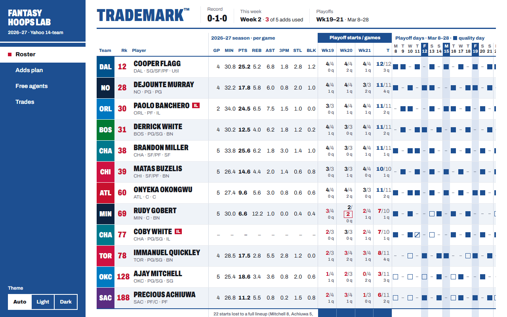
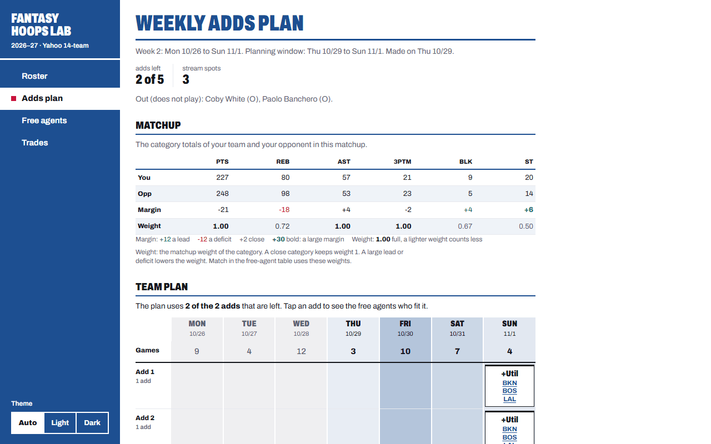
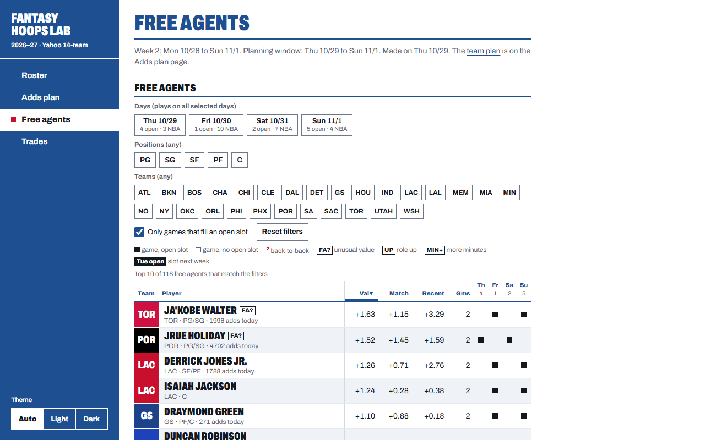
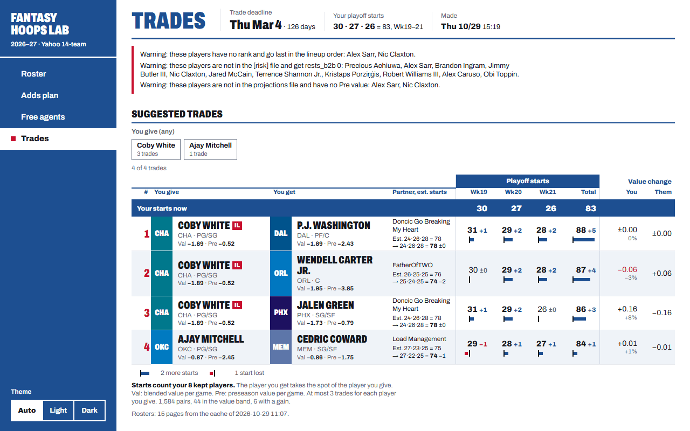

<p align="center">
  <a href="https://mccomark21.github.io/fantasy-hoops-lab/">
    
  </a>
</p>

<h1 align="center">Fantasy Hoops Lab</h1>

<p align="center">
  Custom fantasy basketball tools for one Yahoo league, published as a small website.
</p>

<p align="center">
  <a href="https://mccomark21.github.io/fantasy-hoops-lab/"><b>Open the site</b></a>
  &nbsp;·&nbsp;
  <a href="#documentation">Documentation</a>
  &nbsp;·&nbsp;
  <a href="https://github.com/mccomark21/fantasy-hoops-lab/issues">Planned work</a>
  &nbsp;·&nbsp;
  <a href="https://github.com/mccomark21/fantasy-hoops-lab/actions/workflows/tests.yml"></a>
</p>

## About

Fantasy basketball is one of my favorite hobbies, and this repo is where I play with it. Fantasy Hoops Lab started as a set of custom draft rankings for my league. It grew into a site with one page for each big decision of the season:

- who is on my roster,
- how to use my adds this week,
- which free agents fit,
- which trades help in the playoffs.

The public apps rank players on all 9 categories. My team punts 3 of them (FG%, FT% and TO). I wanted rankings and plans built for the 6 categories that I try to win. Each tool reads my real league and does the math in Python. Then it puts the result on a page that I can open at my desk or on my phone.

These are the tools for one person's team in one league. The settings, the punted categories and the strategy are mine. The site is public, but it is not a general product, and it does not explain itself to new visitors. You are welcome to read the code and take ideas from it.

<table>
  <tr>
    <td width="50%" valign="top">
      <a href="#roster"></a>
      <br><b>Roster</b>: the team in custom-rank order, with playoff starts.
    </td>
    <td width="50%" valign="top">
      <a href="#adds-plan"></a>
      <br><b>Adds plan</b>: the teams and positions to add, and on which day.
    </td>
  </tr>
  <tr>
    <td width="50%" valign="top">
      <a href="#free-agents"></a>
      <br><b>Free agents</b>: the player for each add, with filters.
    </td>
    <td width="50%" valign="top">
      <a href="#trades"></a>
      <br><b>Trades</b>: 1-for-1 trades for playoff weeks 19 to 21.
    </td>
  </tr>
</table>

## The league

| Setting | Value |
| --- | --- |
| Platform | Yahoo, head-to-head, 14 teams |
| Draft | Auction, $200 budget |
| Roster | 10 spots: PG, SG, SF, PF, C, Util and 4 bench |
| Adds | 5 each week |
| Categories | PTS, REB, AST, 3PM, BLK, STL (FG%, FT% and TO are punted) |
| Fantasy playoffs | Weeks 19 to 21 |

## The site

### Roster

The home page shows my roster in custom-rank order, with the season stats of each player from ESPN. For each playoff week, it shows how many games each player can start in the best lineup. It also shows how close the team is to the ideal count.

### Adds plan

The planner finds the open starting slots of each day of the fantasy week. It then recommends which NBA teams and positions to add in each stream spot, and on which day. The week grid shows each add and the days that the new player starts. The page also shows the category totals of this week's matchup.

### Free agents

This page lists the free agents with their value, their recent stats and their games on each day. Use the filters for day, position and team to find the player for an add. A click on an add in the Adds plan opens this page with those filters set. The page also lists the waiver players and the role-up marks: the free agents at the positions of absent starters.

### Trades

The trade tool suggests 1-for-1 trades with the other teams. Each suggestion raises my started games in playoff weeks 19 to 21 and keeps my season value. A trade builder under the table checks a custom trade, for example 2-for-1, in the browser.

### Local only

The draft tools (rankings, the draft board, an auction simulator and a keeper report) are local pages. They are not on the site.

## How it works

1. **Data.** The tools read my league from Yahoo with Playwright and a saved sign-in in Microsoft Edge. The NBA rosters, the schedule and the season stats come from ESPN. A rotation log of each check-in and check-out comes from the ESPN play-by-play. A season projections file gives the projected stats.
2. **Analysis.** The Python package `fantasyhoops` computes player values, lineups, plans and trades. It has one subpackage for each tool and a `core` package for the shared code.
3. **Publish.** Each run writes static HTML pages and pushes them to the `gh-pages` branch. GitHub Pages serves the site.

## Getting started

### Prerequisites

- Python 3.11 or later.
- Microsoft Edge, for the Yahoo sign-in of the adds planner and the trade tool.
- Node.js, for the tests of the JavaScript on the draft board. Without Node, pytest skips those tests.
- `git` on the `PATH`. The publish step and its tests use it.
- A season projections file. Git does not track CSV files, so a new clone does not include it.

### Install

1. Install the package and the test dependencies in editable mode:

   ```sh
   python -m pip install -e ".[test]"
   ```

   To also install ruff for the lint check, use `".[test,lint]"`.

2. Install the browser that `fetch/yahoo.py` uses:

   ```sh
   python -m playwright install chromium
   ```

3. Put the season projections in `data/Projections_YYYY-MM-DD.csv`. Use the download date. The tools use the newest file.

All settings are in [`config.toml`](config.toml). The `[league]` section applies to all tools.

### Run the tools

Run each tool from the repo root with `python -m`:

```sh
python -m fantasyhoops.fetch.espn       # Download NBA rosters and the schedule
python -m fantasyhoops.fetch.rotation   # Add the finished games to the rotation log
python -m fantasyhoops.adds.plan        # Plan the adds, write the pages and publish the site
python -m fantasyhoops.trade            # Suggest trades and publish the Trades page
python -m fantasyhoops.draft.board      # Write the local draft board
```

The first Yahoo run opens an Edge window. Sign in to Yahoo by hand in that window. Later runs use the saved session in `.auth/yahoo/`.

To write the pages with no publish, add `--no-publish` to the adds or trade command.

### Test

```sh
python -m pytest
ruff check src tests
```

## Documentation

| Document | Contents |
| --- | --- |
| [Adds planner](docs/adds/README.md), [trade tool](docs/trade/README.md), [draft tools](docs/draft/README.md) | One guide for each tool: its goal, usage, data and decisions. |
| [Glossary](docs/glossary.md) | The terms that more than one tool uses, for example core, stream spot and kept set. |
| [Architecture decisions](docs/adr/) | The architecture decision records. |
| [Wiki](docs/wiki/index.md) | The dated history and the decisions of the project. |
| [PRODUCT.md](PRODUCT.md), [DESIGN.md](DESIGN.md) | Who the site is for and how it looks. |
| [GitHub issues](https://github.com/mccomark21/fantasy-hoops-lab/issues) | The planned work. |
